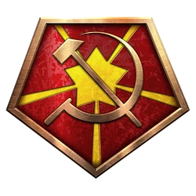
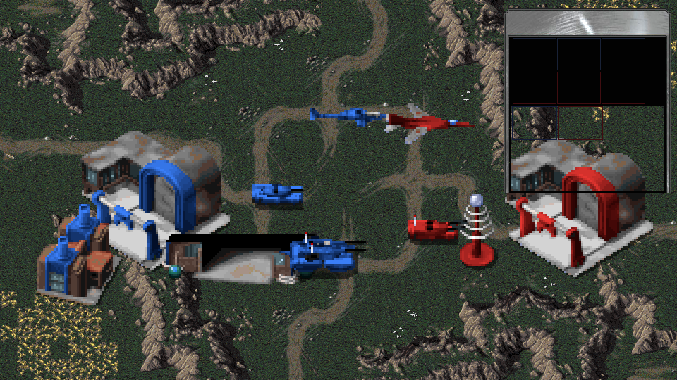

<p align="center">
  
</p>

<h1 align="center">Command & Conquer: Red Alert — Autobattle & RTS HD-2D</h1>

<p align="center">
  <b>An authentic Red Alert 2.5D HD-2D RTS & Autobattle experience built in Godot 4.7 using 100% original OpenRA assets.</b><br/>
  <i>Trải nghiệm Red Alert 2.5D HD-2D (RTS & Autobattle) xây dựng trên Godot 4.7 sử dụng 100% tài nguyên gốc từ OpenRA.</i>
</p>

<p align="center">
  
</p>

---

## Language / Ngôn ngữ
- [English](#-english)
- [Tiếng Việt](#-tiếng-việt)

---

## 🇬🇧 English

### Overview
**Red Alert: Autobattle & RTS HD-2D** brings classic *Command & Conquer: Red Alert* into a tilted 2.5D HD-2D oblique camera (`-56°` orthographic) in **Godot 4.7**, powered by authentic sprites, maps, palettes, shadows (`ShadowIndex: 4`), UI chrome, and audio extracted directly from **OpenRA**.

### Game Modes
1. **Skirmish (100% Red Alert RTS):**
   - Choose **Allies** (`2TNK`, `ARTY`, `HELI`, `YAK`, `GUN`, `PDOX`) or **Soviet** (`3TNK`, `4TNK`, `V2RL`, `HIND`, `MIG`, `TSLA`, `IRON`).
   - Select from **3 OpenRA Maps**: `Crossfire (128x128)`, `A Nuclear Winter (100x70)`, and `Fort Lonestar (48x48)`.
   - Start with a **Construction Yard** or **MCV**, deploy anywhere buildable, manage **Power** (`POWR` / `APWR`), harvest **Gold Ore & Gems** with **Harvesters (`HARV`)**, build defenses (`PBOX`, `GUN`, `TSLA`, `SAM`), and unleash **Superweapons** (`Chronosphere`, `Iron Curtain`, `Nuclear Silo`).
   - Optional **Fog of War (`Shroud`)** & **Radar Dome** requirement for the live Minimap.
2. **Campaign (3 Missions):**
   - **M1: Outpost** — Lead a forward base assault against fortified Pillboxes & patrols.
   - **M2: Harvester Siege** — Escort your MCV & Harvester against an entrenched Refinery & Tesla/Turret line.
   - **M3: Crossfire Overlord** — Full-scale late-game siege with Heavy Tanks, Airfields & AA networks.
3. **Autobattle Mode:**
   - Fast-paced automated wave battles with **OpenRA Squad AI** (`GATHER` / `ATTACK` / `PROTECT`), **Armor vs. Warhead (`Versus`)** targeting, and unit separation steering.

### Key Features
- **100% Authentic OpenRA Assets:** Crisp nearest-neighbor 24px/tile scaling, original pixel shadows, 8-direction infantry walk/death animations (`die1`), 32-direction vehicle hulls + **independent rotating tank turrets**, spinning helicopter rotors, scorch craters, and charred vehicle husks.
- **Classic Red Alert UI & Audio:** Original `sidebar.png` / `dialog.png` chrome, vertical **Power Bar**, `BLD` / `UNT` / `REP` / `SELL` controls, Cameo build progress curtain, dynamic `mouse.shp` cursors, spatial camera-attenuated SFX, unit voices (`await1`, `ackno`, `affirm1`), and EVA alerts (`baseatk1`, `conscmp1`, `nofunds1`).
- **RTS Controls:**
  - **Left-Click / Drag:** Select unit(s) (`Shift` to add)
  - **Right-Click:** Move / Attack / Capture with Engineer (`e6`) / Set Building Rally Point
  - **Right-Drag / Middle-Drag / Arrow Keys:** Pan camera | **Mouse Wheel:** Zoom
  - **`D`:** Deploy MCV | **`A`:** Attack-Move | **`S`:** Stop | **`Ctrl + 1..5` / `1..5`:** Control Groups | **`ESC`:** Game Menu

### Running the Project
1. Install **Godot Engine 4.7+** (`Forward Plus`).
2. Clone this repository and open `project.godot` in Godot, or run:
   ```bash
   Godot_v4.7.2-stable_win64.exe --path .
   ```

---

## 🇻🇳 Tiếng Việt

### Giới thiệu
**Red Alert: Autobattle & RTS HD-2D** tái hiện *Command & Conquer: Red Alert* dưới góc nhìn 2.5D HD-2D (`-56°` Orthographic) trên **Godot 4.7**, sử dụng **100% sprite, bản đồ, bảng màu, bóng pixel gốc (`ShadowIndex: 4`), giao diện Sidebar/Dialog và âm thanh** được trích xuất trực tiếp từ **OpenRA**.

### Các chế độ chơi
1. **Skirmish (RTS chuẩn Red Alert 100%):**
   - Chọn phe **Allies** (`2TNK`, `ARTY`, `HELI`, `YAK`, `GUN`, `Chronosphere`) hoặc **Soviet** (`3TNK`, `4TNK`, `V2RL`, `HIND`, `MIG`, `Tesla Coil`, `Iron Curtain`).
   - Hỗ trợ **3 bản đồ gốc OpenRA**: `Crossfire (128x128)`, `A Nuclear Winter (100x70)`, `Fort Lonestar (48x48)`.
   - Khởi đầu bằng **Nhà chính** hoặc **MCV**, quản lý **Điện năng** (`POWR`/`APWR`), xe **Harvester (`HARV`)** tự động khai thác mỏ vàng/đá quý, xây dựng tháp phòng thủ (`PBOX`, `GUN`, `TSLA`, `SAM`), **Kỹ sư (`e6`)** chiếm nhà địch, và **3 Siêu vũ khí** (`Chronosphere`, `Iron Curtain`, `Nuclear Silo`).
   - Tùy chọn bật/tắt **Fog of War** và cơ chế **Radar Dome** mở khóa Minimap.
2. **Campaign (3 Màn Chiến Dịch):**
   - **M1: Outpost** — Đột kích tiền đồn phòng thủ của đối phương.
   - **M2: Harvester Siege** — Bảo vệ MCV & xe đào vàng vượt tuyến phòng thủ Tesla/Turret.
   - **M3: Crossfire Overlord** — Tổng lực công thành với Siêu tăng, Sân bay & phòng không.
3. **Autobattle Mode:**
   - Chế độ tự động giao tranh theo từng đợt quân với **AI Squad OpenRA** (`GATHER` / `ATTACK` / `PROTECT`), bảng khắc chế **Giáp – Đầu đạn (`Versus`)** và tách đơn vị chống chồng chéo.

### Điều khiển & Phím tắt
| Phím / Chuột | Chức năng |
| :--- | :--- |
| **Chuột trái / Kéo khung** | Chọn đơn vị (`Shift` để chọn thêm) |
| **Chuột phải** | Di chuyển / Tấn công / Cho Kỹ sư (`e6`) chiếm nhà / Đặt Rally Point cho nhà |
| **Kéo chuột phải/giữa hoặc Phím mũi tên** | Di chuyển camera |
| **Cuộn chuột** | Phóng to / Thu nhỏ |
| **`D`** | Triển khai MCV thành Construction Yard |
| **`A`** | Attack-Move (Vừa đi vừa đánh) |
| **`S`** | Dừng đơn vị |
| **`Ctrl + 1..5` / `1..5`** | Gán và gọi nhanh nhóm quân (bấm 2 lần để nhảy camera) |
| **`ESC`** | Mở Menu chọn chế độ / Bản đồ |

### Cấu trúc thư mục
- `scenes/Main.tscn` — Scene chính
- `scripts/Main.gd` — Menu, HUD/Sidebar OpenRA, Fog of War, Input & Placement Preview
- `scripts/BattleManager.gd` — Lõi RTS, AI Skirmish, Squad AI, Vũ khí/Khắc chế, Siêu vũ khí, Âm thanh
- `scripts/RtsData.gd` — Thông số công trình, đơn vị, cây công nghệ Allies & Soviet
- `scripts/Terrain3D.gd` — Dựng địa hình 3D, cây cối, mỏ vàng & `AStarGrid2D`
- `scripts/RtsCamera.gd` & `scripts/Minimap.gd` — Camera nghiêng HD-2D và Radar Minimap
- `assets/` — Sprites, Maps, UI Chrome, Fonts (`Tiny5-Regular`) & Audio xuất từ OpenRA

---

### Attribution / Bản quyền tài nguyên
- Visual & audio assets are exported from **[OpenRA](https://www.openra.net/)** (Red Alert mod, GPLv3) for educational/fan-remake purposes.
